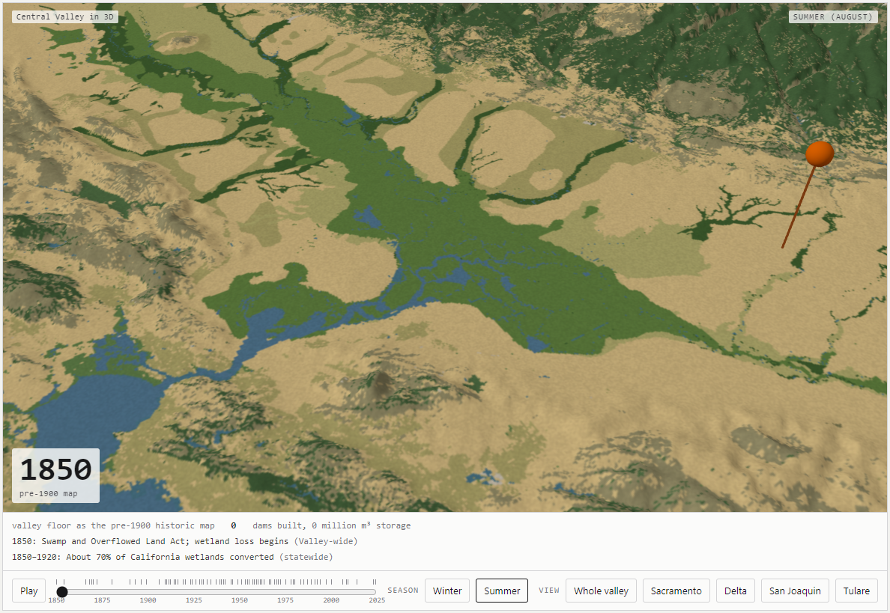

# The Central Valley in 3D, before 1900 to 2025

California's Central Valley and the mountains around it, on real terrain, with the land cover of each year from 1850 to 2025. The valley floor follows the USGS CVHM2 land-use record (1874 to 2019) and, where land stayed native, the vegetation of the pre-1900 historic map. Dams, canals and dated events appear in their years. There is a summer and a winter view.

The page opens on the case and the other explanation (a change in the weather from the Pacific), then a guided walkthrough of 15 chapters in seven parts: the valley before and after; the ground lost its water; the low air after rain; cloud and rain; where the change is, and where it is not; where water is returned; settled, and what is measured next. Each chapter gives one result in a large line, what the weather reading would predict beside what was measured, and the numbers and sources in a fold. Three chapters add a side view from the ocean to Reno. The first chapters play the land use through their years (1874 to 1930, 1930 to 1975, 1975 to 2019), and each chapter shows only its own markers; hold "Land underneath" (or the space bar) to see the land under any layer. At the end, or at any time, the map is free to explore with all its layers; Play runs the land use from 1850 to 2025, and the Walkthrough button starts the story again.

Live page: https://r3genesi5.github.io/central-valley-3d/

The page opens on the valley before 1900 and in 2019 side by side: drag the line to compare. Controls: Compare (two years, a draggable line, C); a 2D map (north up, one scale, true scale bar, M) beside the tilted 3D view; a compass (N); Play for the land use 1850 to 2025; layers grouped by question (the ground, the low air, rain) with a strength slider and a legend on the map; hold Land underneath (or the space bar) to see the land under any layer; Plate makes a print plate of the 2D view (A3 or A4, PNG or PDF, 300 dpi) in the layout of the project's map plates, or a request file for the QGIS route (`build/valley3d_plate_qgis.py`); How to use steps through the controls.

`index.html` is the page (three.js 0.160.0 from jsDelivr). It loads `data/`:
- `dem.png`: terrain at 1 km, EPSG:3310;
- `floor.png`: CVHM2 cell index and pre-1900 vegetation type at 300 m;
- `cover.png`: NLCD 2025, reservoir dam year and ocean at 300 m;
- `meta.json`: yearly land-use codes, dams, events, dated canals, the Tulare Lake 1862 stage and cell corners.

`build/valley3d_prep.py` built the data. It reads files from the author's project tree and is included for the record.

## Sources
- **Land use**: USGS Central Valley Hydrologic Model 2 (CVHM2) land use v3, annual 1874-2019 (ScienceBase).
- **Pre-1900 vegetation**: Central Valley Historic Mapping Project, Geographical Information Center, California State University, Chico. Obtained from Data Basin (Conservation Biology Institute), displayed here for non-commercial purposes.
- **Terrain**: Copernicus GLO-90 DEM (© DLR e.V. 2010-2014 and © Airbus Defence and Space GmbH 2014-2018, provided under COPERNICUS by the European Union and ESA).
- **Hills**: USGS Annual NLCD Collection 1 v2, 2025.
- **Dams**: Global Dam Watch v1.0, barriers and reservoir outlines. Each dam is drawn as a wall from the year it was built, laid across the outlet end of its own reservoir (else across the nearest river line, else across the slope of the ground); a longer wall holds more water.
- **Degree of regulation (DOR)**: storage upstream as a share of the mean yearly natural flow. Per river: GAGES-II dam storage in each gauge basin by date (before 1940 to 2009) over the CDEC natural flow. Per dam: Global Dam Watch DOR, which uses GDW's modelled flow at the dam and reads high where that flow is low. Regional totals before 1900, 1940, 1970 and now: `build/valley3d_regulation_totals.py`; per river and dam: `build/valley3d_dor.py`.
- **Rain on fixed gauges, slope and north**: GHCN-Daily gauges with complete records in both eras, from the project's test records named on the page.
- **Mountains**: forest stand age (Pan et al. 2011); Hansen Global Forest Change v1.11 loss year; USGS Annual NLCD 1985-2025; CAL FIRE fire perimeters 1878-2025 (California_Fire_Perimeters_Time_Enabled_View).
- **Rain**: PRISM monthly precipitation, 4 km, 1895-2025 (PRISM Climate Group, Oregon State University).
- **Surface temperature**: MODIS Aqua MYD11A1 v6.1 daytime land surface temperature, 2003-2025.
- **Cloud base**: the project's three WRF runs, winter 2013-14 (model output, read for direction only; numbers on the 246 storm hours common to all three, no map).
- **Water table**: USGS Water-Supply Papers well measurements 1905-14 (digitised by the project); California DWR periodic groundwater levels, spring 2015-2024.
- **Evaporation**: June-September only; now, SSEBop satellite; then, class rates of the pre-1900 vegetation (project estimate). No whole-floor season totals are shown.
- **Wet land**: pre-1900 historic map and CVHM2 cells on the map; totals from the project's wet-layer inventory on a 30 m grid.
- **Fog and the cold layer**: NOAA ISD hourly reports at 11 floor airports; GHCN-Daily hill and floor station pairs (southern Sierra).
- **Rain by height**: GHCN-Daily rain gauges on the floor and the Sierra windward slope, storm classes from ERA5; rain per unit of offshore storm vapour from the project's corridor test.
- **Rivers and creeks on the map**: USGS NHD flowlines (named streams; today's channels) and Natural Earth rivers outside the NHD extent.
- **Rivers**: CDEC full natural flow and USGS NWIS flow below the rim dams.
- **Rain per unit of vapour**: the project's station test (29 of 137 stations).
- **Coast to crest corridor**: one track of 400 km from 37.80 N, 123.50 W on bearing 71 degrees, in 25 km bins. Rain per unit of offshore inflow from PRISM daily rain and ERA5 vapour transport; afternoon air, drying after rain and fog from NOAA ISD hourly reports at nine airports; the sea from NDBC buoy 46026. Values are copied from the project's test records named on the page.
- **Major roads, 2023**: US Census TIGER/Line 2023 primary and secondary roads, California. Drawn widths from the Caltrans Highway Design Manual, chapter 300 (2020): lanes, shoulders, median and clear recovery zone. The freeway road-effect zone, about 600 m, from Forman and Deblinger 2000 (Conservation Biology 14: 36-46), as given in summaries of that paper.
- **Winds**: ERA5 column vapour flux (0.25°), 2 m temperature and dew point (cloud base, 125 m per kelvin of their gap) and column water vapour (WeatherBench-2, 1.5°), as means over storm days (offshore inflow of at least 150 kg/m/s on the corridor) and the afternoon after, winters 1959-60 to 1979-80 and 1999-2000 to 2021-22. A reanalysis: a then-and-now difference mixes land and weather. `build/valley3d_wind.py`.
- **Wind streak colour and air temperature**: streaks coloured by ERA5 column water vapour (6 to 21 mm); 2 m air temperature of the same storm days (`build/valley3d_wind_t2m.py`).
- **Model of the low air over the old land and today's land**: the project's WRF pair, winter 2013-14 (12 km): 10 m wind, 2 m air temperature and vapour, heat and evaporation from the ground, afternoon, pre-dawn and storm hours (`build/valley3d_wrf_wind.py`). Shown as a stand-in until the read of the same-land run that measures how far two free runs drift apart.
- **Towns on the floor**: NLCD developed pixels inside the cells CVHM2 calls towns, in one grey; burns from CAL FIRE perimeters in red-brown (first year) and orange (second and third).
- **Name labels**: dams (Global Dam Watch), rivers (NHD, Natural Earth), roads (TIGER 2023) and stations, in the View menu.
- **Events**: the author's project chronology.
- **Fire, times burnt**: CAL FIRE perimeters (as above), separate fire years per 300 m place in 1950-1987 and in 1988-2025, 38 years each; the perimeter record before about 1950 is incomplete, so both spans start in 1950 (`build/valley3d_fire_counts.py`). Burnt at least once: 23,639 km2 and 63,972 km2; twice or more: 2,306 km2 and 13,678 km2.
- **Where the water goes** (support layer, reported records, off at start): rivers in, CDEC full natural flow (water years); federal deliveries, USBR CVO; state deliveries, DWR Bulletin 132-25 Table B-5B; Delta exports and outflow, Dayflow; water rights, eWRIMS; city water, SWRCB urban retail supplier reports; sewage, CIWQS self-monitoring reports (`build/valley3d_water_use.py`, `build/valley3d_water_use_s2.py`, `build/valley3d_water_rights_s3b.py`).

## Kinds of layer
Each layer card says what it is: **Measured** (wells, river flow, rain stations, fog and station pairs, the coast-to-crest corridor, flux towers, satellite surface temperature, rain), **Mapped** (land cover, wet land), **Estimated** (anything "then" built from class rates) or **Model** (cloud base; the low air over the old land and today's land), and **Reanalysis** (the winds). No layer shows a whole-floor, whole-season average of then against now.

## What is estimated
- **Before 1874**: the floor is the pre-1900 map.
- **After 2019**: the floor holds at 2019.
- **Native land**: native cells take their pre-1900 vegetation. A pre-1900 wet cell that CVHM2 no longer calls groundwater-fed is drawn as drained native land.
- **Hills**: NLCD 2025 is projected back in time.
  - Reservoirs appear from the year their dam was built, using the GDW reservoir outlines. Lake Tahoe, which GDW marks as a natural lake held by a dam, is always water.
  - Forest: older forest before the stand establishment year from stand age, cleared for five years, then regrowing.
  - Forest loss 2001-2023 (Hansen): a scar for four years, then regrowth.
  - Fires 1878-2025 (CAL FIRE): a scar for three years (one on grass), then regrowth over twelve years. The record before about 1950 is incomplete.
  - Towns appear in the first NLCD year (1990-2025) the pixel is developed.
  - Towns and farms fall back to grass or oak before rough start years.
- **Drawing only, not measured**: the field pattern, roads on section lines, season colours and snow.
- **Terrain** is drawn 4 times higher than real.

Ali Bin Shahid, November 2026.
