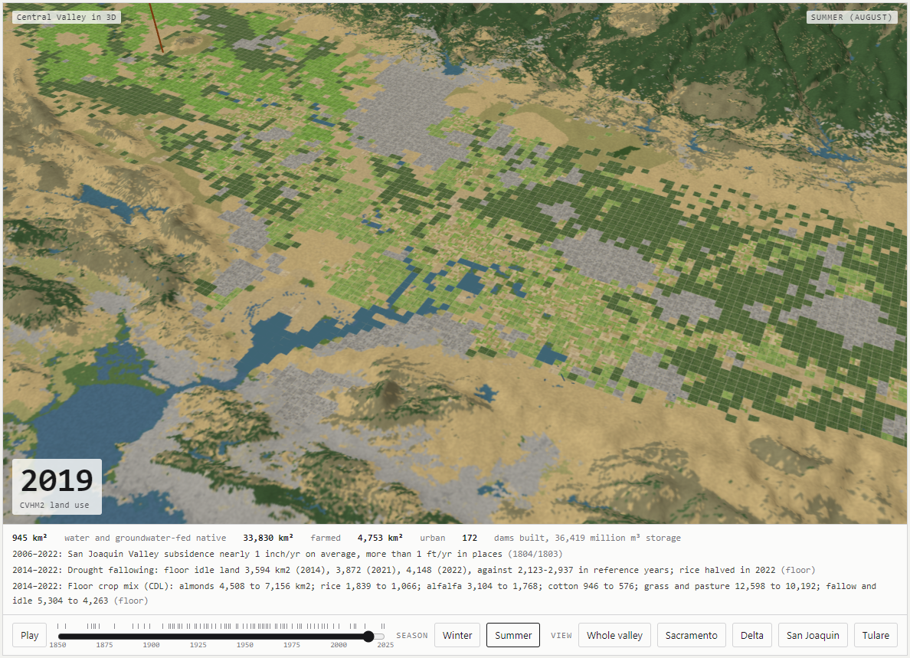

# The Central Valley in 3D, before 1900 to 2025

California's Central Valley and the mountains around it, on real terrain, with the land cover of each year from 1850 to 2025. The valley floor follows the USGS CVHM2 land-use record (1874 to 2019) and, where land stayed native, the vegetation of the pre-1900 historic map. Dams, canals and dated events appear in their years. There is a summer and a winter view.

Live page: https://r3genesi5.github.io/central-valley-3d/

`index.html` is the page (three.js 0.160.0 from jsDelivr). It loads `data/`:
- `dem.png`: terrain at 1 km, EPSG:3310;
- `floor.png`: CVHM2 cell index and pre-1900 vegetation type at 300 m;
- `cover.png`: NLCD 2025, reservoir dam year and ocean at 300 m;
- `meta.json`: yearly land-use codes, dams, events, dated canals, the Tulare Lake 1862 stage and cell corners.

`build/valley3d_prep.py` built the data. It reads files from the author's project tree and is included for the record.

## Sources
- **Land use**: USGS Central Valley Hydrologic Model 2 (CVHM2) land use v3, annual 1874-2019 (ScienceBase).
- **Pre-1900 vegetation**: Central Valley Historic Mapping Project, Geographical Information Center, California State University, Chico. Obtained from Data Basin (Conservation Biology Institute), displayed here for non-commercial purposes.
- **Terrain**: Copernicus GLO-90 DEM (© DLR e.V. 2010-2014 and © Airbus Defence and Space GmbH 2014-2018, provided under COPERNICUS by the European Union and ESA).
- **Hills**: USGS Annual NLCD Collection 1 v2, 2025.
- **Dams**: Global Dam Watch v1.0, barriers and reservoir outlines.
- **Mountains**: forest stand age (Pan et al. 2011); Hansen Global Forest Change v1.11 loss year; USGS Annual NLCD 1985-2025; CAL FIRE fire perimeters 1878-2025 (California_Fire_Perimeters_Time_Enabled_View).
- **Rain**: PRISM monthly precipitation, 4 km, 1895-2025 (PRISM Climate Group, Oregon State University).
- **Surface temperature**: MODIS Aqua MYD11A1 v6.1 daytime land surface temperature, 2003-2025.
- **Cloud base**: the project's three WRF runs, winter 2013-14 (model output, read for direction only; numbers on the 246 storm hours common to all three, no map).
- **Water table**: USGS Water-Supply Papers well measurements 1905-14 (digitised by the project); California DWR periodic groundwater levels, spring 2015-2024.
- **Evaporation**: June-September only; now, SSEBop satellite; then, class rates of the pre-1900 vegetation (project estimate). No whole-floor season totals are shown.
- **Wet land**: pre-1900 historic map and CVHM2 cells on the map; totals from the project's wet-layer inventory on a 30 m grid.
- **Fog and the cold layer**: NOAA ISD hourly reports at 11 floor airports; GHCN-Daily hill and floor station pairs (southern Sierra).
- **Rain by height**: GHCN-Daily rain gauges on the floor and the Sierra windward slope, storm classes from ERA5; rain per unit of offshore storm vapour from the project's corridor test.
- **Rivers and creeks on the map**: USGS NHD flowlines (named streams; today's channels) and Natural Earth rivers outside the NHD extent.
- **Rivers**: CDEC full natural flow and USGS NWIS flow below the rim dams.
- **Rain per unit of vapour**: the project's station test (29 of 137 stations).
- **Events**: the author's project chronology.

## Kinds of layer
Each layer card says what it is: **Measured** (wells, river flow, rain stations, fog and station pairs, satellite surface temperature, rain), **Mapped** (land cover, wet land), **Estimated** (anything "then" built from class rates) or **Model** (cloud base). No layer shows a whole-floor, whole-season average of then against now.

## What is estimated
- **Before 1874**: the floor is the pre-1900 map.
- **After 2019**: the floor holds at 2019.
- **Native land**: native cells take their pre-1900 vegetation. A pre-1900 wet cell that CVHM2 no longer calls groundwater-fed is drawn as drained native land.
- **Hills**: NLCD 2025 is projected back in time.
  - Reservoirs appear from the year their dam was built, using the GDW reservoir outlines. Lake Tahoe, which GDW marks as a natural lake held by a dam, is always water.
  - Forest: older forest before the stand establishment year from stand age, cleared for five years, then regrowing.
  - Forest loss 2001-2023 (Hansen): a scar for four years, then regrowth.
  - Fires 1878-2025 (CAL FIRE): a scar for three years (one on grass), then regrowth over twelve years. The record before about 1950 is incomplete.
  - Towns appear in the first NLCD year (1990-2025) the pixel is developed.
  - Towns and farms fall back to grass or oak before rough start years.
- **Drawing only, not measured**: the field pattern, roads on section lines, season colours and snow.
- **Terrain** is drawn 4 times higher than real.

Ali Bin Shahid, November 2026.
